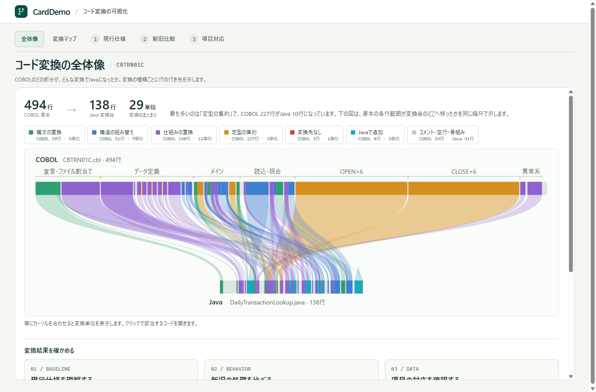
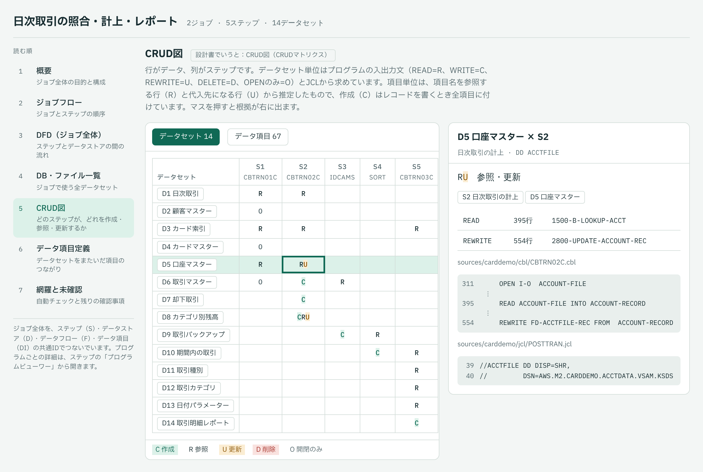
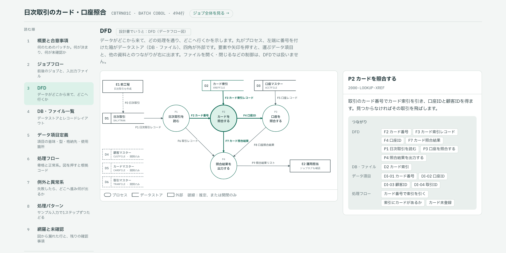
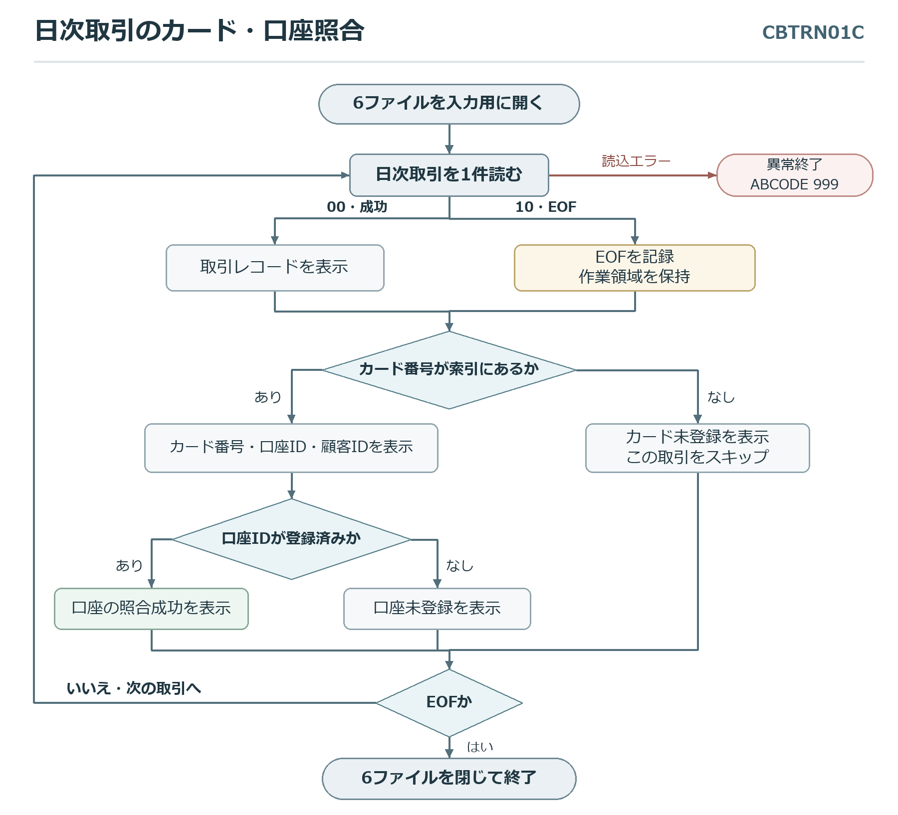
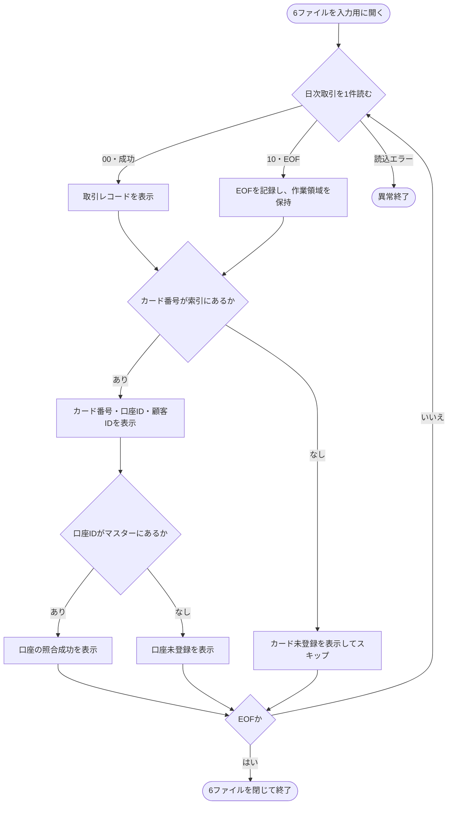

# CardDemo バッチのコード解析と可視化

AWS のメインフレーム移行サンプル CardDemo の COBOL バッチを題材に、現行コードを読み解いて設計書の形で見せる仕組みと、COBOL から Java への変換をレビューする仕組みをまとめたリポジトリです。ビューアーはどれも、リポジトリを取得してブラウザーで開くだけで動く単独 HTML です。

| 開くもの | 内容 |
|---|---|
| [viewer.html](viewer.html) | コード変換の可視化。CBTRN01C（COBOL 494行）を Java 138行へ移した変換の全体像と、現行仕様・新旧比較・項目対応のレビュー |
| [batch-viewer/CBTRN01C.html](batch-viewer/CBTRN01C.html) | プログラムビューワー。1本のバッチを、概要・DFD・DB／ファイル一覧・データ項目定義・処理フローなど設計書の順に読む |
| [batch-viewer/daily-job.html](batch-viewer/daily-job.html) | ジョブビューワー。3プログラムと JCL をまたいで、ジョブ全体の DFD・DB／ファイル一覧・CRUD 図・データ項目定義をまとめる |

<details>
<summary>フォルダー構成</summary>

| パス | 内容 |
|---|---|
| `original/` | CBTRN01C の COBOL 原本（固定版）とライセンス |
| `DailyTransactionLookup.java`、`sample/` | CBTRN01C の Java 版と、同梱の架空データ |
| `viewer.html`、`review/`、`scripts/` | コード変換ビューアーと、その台帳・生成と検証のスクリプト |
| `batch-viewer/` | バッチ設計ビューワー（生成した HTML、モデル、データ辞書） |
| `sources/carddemo/` | ジョブビューワー用に取り込んだ CBTRN02C・CBTRN03C、COPY 句、JCL、PROC（[取得元](sources/carddemo/NOTICE.md)） |
| `.agents/skills/` | 解析と可視化の手順をまとめたプロジェクト内スキル（[一覧](#プロジェクト内のスキル)） |

</details>

## 題材：CBTRN01C 日次取引のカード・口座照合

1件の日次取引からカード番号を取り出し、カード索引で口座IDを引き、口座マスターにそのIDがあるかを確認するバッチです。6ファイルを入力用に開き、照合結果を標準出力に表示します。[COBOL原本](original/CBTRN01C.cbl) · [Java版](DailyTransactionLookup.java)

## コード変換の可視化

デモは、リポジトリを取得して `viewer.html` をブラウザーで開くだけで動きます（外部通信なし・単一HTML）。

[ビューアー](viewer.html)は、COBOL 494行がJava 138行になった変換の全体像から開きます。原本の各行範囲が変換後のどこへ移ったかを同じ縮尺の帯で結び、変換の種類で色分けします。帯か種類を押すと「変換マップ」が開き、変換単位ごとに変換元と変換先のコードを並べて確認できます。



| 変換の種類 | 意味 | COBOL行数 | 単位 |
|---|---|---|---|
| 構文の置換 | 文や宣言がほぼ1対1でJavaの構文に置き換わる | 39 | 5 |
| 構造の組み替え | フラグ・状態コード・段落分割を、制御構造やメソッドへ組み替える | 51 | 7 |
| 仕組みの置換 | ファイル編成・レコード領域・異常終了を、Javaの別の仕組みで実現する | 140 | 11 |
| 定型の集約 | 繰り返しの定型処理を、共通メソッドや言語機能にまとめる | 227 | 2 |
| 変換先なし | Javaに対応するコードがない | 3 | 1 |
| Javaで追加 | COBOLに由来する文がなく、Java側で加えた | 0 | 3 |

行数が減った主因は、OPEN／CLOSEの定型12段落（227行）が`open()`と`try-with-resources`の10行にまとまったことです。COBOLの各行は、29の変換単位のどれか1つか、コメント・空行（34行）に属します。Javaの各行は1つ以上の単位に由来するか、import・括弧・コメント・空行（41行）です。変換マップではコード左端の色が変換の種類を示し、行を押すとその行の変換単位が開きます。各単位からは、関係する新旧比較の項目へ移動できます。

対応は[変換台帳](review/conversion-map.json)に保存しています。台帳はこの固定版のソースを読んで整理したもので、`python -X utf8 scripts/build_conversion_map.py`が全行の分類漏れ・重複を検査してHTMLへ埋め込みます。行の行き先を示すもので、挙動が同じであることの証拠ではありません。

## 変換結果のレビュー

変換の全体像の下に、結果を確かめる3つの視点を置いています。「1 現行仕様」では原本と処理フロー、「2 新旧比較」では旧新の処理の対応と差分、「3 項目対応」では変数・レコード・ファイルの対応を表示します。[工程の目的・成果物・現在の未確認事項](review/WORKFLOW.md)と、プロジェクト内の3つの専門スキルを用意しています。

現行仕様ではJavaを隠し、図と原本に集中できます。図をクリックしてコードへ、コードの行をクリックして対応する図の候補や未登録一覧へ移動できます。新旧比較では両方の該当行を強調し、左右・上下に並べ替えられます。各ファイル名の横の行番号リストで、呼出元や処理本体へ移動できます。

新旧比較は10項目の対応・差分・前提を収録しています。マスター読込時点、CLOSE順序、診断の差などを、コード根拠と次の確認事項付きで表示します。項目対応はレコード71項目・制御変数37項目・ファイルI/F 6件を対象とし、個別対応、全体保持、開閉のみ、表現の変更、未整理を区別します。処理比較と関連項目の間を行き来できます。

「処理パターン」では、同梱3件を順にたどる全25ステップのほか、照合成功、カード未登録、口座未登録を1件ずつ選べます。空入力では最初の読込でEOFになり、読込エラーの例では異常終了へ進みます。各パターンはソースとサンプルから再構成した処理順です。

現行の「条件・入出力」には原本の条件と項目を表示します。新旧比較の「ケースで辿る」から判定を開くと、COBOLとJavaの実際の式を比較できます。「I/F定義一覧」はCOPY句から抽出した71項目（FILLERを含む）の名前、PIC、位置、格納例を収録します。このビューアーの台帳はCOPY句全文なしで作成しています（COPY句は後から[`sources/carddemo/`](sources/carddemo/NOTICE.md)に同梱）。原本・Javaの全文、定義抽出値、サンプル、対応台帳はHTMLに埋め込んであります。

## バッチ設計ビューワー

COBOLバッチとJCLから、ジョブフロー・DFD・DB／ファイル一覧・CRUD図・データ項目定義・処理フローを共通のIDでつないだ単独HTMLを作ります。どの資料を開いても、詳細欄の「つながり」から他の資料の該当箇所と根拠の行へ移れます。

- [プログラムビューワー（CBTRN01C）](batch-viewer/CBTRN01C.html)：1本のプログラムを「概要 → ジョブフロー → DFD → DB・ファイル一覧 → データ項目定義 → 処理フロー → 例外 → 処理パターン → 網羅」の順に読めます。
- [ジョブビューワー](batch-viewer/daily-job.html)：CBTRN01C・CBTRN02C・CBTRN03C と JCL（POSTTRAN・TRANREPT）をまたいで、14データセットを DSN でまとめ、ジョブ全体のDFDとCRUD図（データセット単位・項目単位）を作ります。CBTRN01C には JCL が無いため事前チェックとして仮に置いており、仮定の箇所は画面で区別しています。





画面は、人が理解しやすい順（目的 → データ → 骨格 → 例外 → 細部）に並べています。

| 画面 | プログラムビューワー | ジョブビューワー | 設計書でいうと |
|---|---|---|---|
| 概要 | 合意が必要な観点ごとに、根拠あり・推定・未確認を区別 | ジョブとステップの一覧 | バッチ処理一覧 |
| ジョブフロー | プログラムの前後と入出力ファイル | ジョブとステップの実行順、DD とデータセットの対応 | ジョブフロー図 |
| DFD | プロセス・データフロー・データストア | ステップとデータセットの流れ（読むだけ／作成・更新で上下に分ける） | DFD |
| DB・ファイル一覧 | 編成・キー・レコードレイアウトと使う項目 | 全データセットを DSN でまとめ、どのステップが使うか | DB一覧・ファイル一覧 |
| CRUD図 | — | データセット単位と項目単位。マスから根拠の行と JCL へ | CRUD図 |
| データ項目定義 | 同じ意味の項目を1つにまとめ、格納先と使用行へ | データセットをまたいだ項目と、ステップごとの CRUD | データ項目定義書 |
| 処理フロー・例外・処理パターン | 流れ図、例外の一覧、サンプル入力でのステップ実行 | ステップからプログラムビューワーへ | 処理フロー、エラー処理一覧 |
| 網羅と未確認 | 全行の分類と、図に載っていない行 | 自動チェック（DD と SELECT の食い違い、仮置き、ジョブ外とのやり取り） | レビュー記録・課題一覧 |

共通の ID は、S（ステップ）、P（プロセス）、F（データフロー）、D（データストア）、DI（データ項目）です。設計書の様式は、IPA『機能要件の合意形成ガイド』など一般的なバッチ設計書の構成を参考にしていますが、ガイドの章立てと1対1で対応させたものではありません。

### 作り方

ソースから取れる事実（入出力文・レイアウト・DD）はスクリプトで抽出し、業務上の名前や処理のまとまり、仮定はモデル（[batch-viewer/models](batch-viewer/models/)）に書きます。COBOL 項目名と日本語のデータ項目名の対応は、両方のビューワーで共有する [データ辞書](batch-viewer/dictionary.json) に書きます。HTML はモデルとソースから生成するので、直接編集しません。

```sh
S=.agents/skills/batch-design-viewer/scripts
python -X utf8 $S/build_viewer.py program batch-viewer/models/CBTRN01C.program.json --out batch-viewer/CBTRN01C.html
python -X utf8 $S/build_viewer.py job batch-viewer/models/daily-job.job.json --out batch-viewer/daily-job.html
node $S/smoke_test.js batch-viewer/CBTRN01C.html batch-viewer/daily-job.html
```

`build_viewer.py` は、モデルが存在しない処理・項目・行番号を参照していると、何も書き出さずに止まります。`smoke_test.js` は Node.js と Playwright で、全画面の表示、つながりのリンク、幅400pxでの横はみ出しを確認します。別のプログラムやジョブに広げるときは、[batch-design-viewer スキル](.agents/skills/batch-design-viewer/SKILL.md)の手順に沿ってモデルを書きます。モデルの書き方は [program-model.md](.agents/skills/batch-design-viewer/references/program-model.md) と [job-model.md](.agents/skills/batch-design-viewer/references/job-model.md) にあります。

ジョブ構成には仮定を含みます。CBTRN01C には JCL が無いため POSTTRAN の前の事前チェックとして仮置きし、TRANREPT を POSTTRAN の後に流す順序も仮定です（取得元ではオンライン画面から投入）。REPROC の IDCAMS 制御文は未入手で、処理内容は推定です。項目単位の CRUD は項目名の参照と代入先からの推定です。いずれも画面では破線や「推定」「仮置き」で区別しています。

## プロジェクト内のスキル

`.agents/skills/` に、解析と可視化の手順をスキルとしてまとめています。エージェントに依頼するときは、`$スキル名 を使って…` のように名前を指定します。

| スキル | 使う場面 |
|---|---|
| [batch-design-viewer](.agents/skills/batch-design-viewer/SKILL.md) | COBOL バッチと JCL から、ジョブフロー・DFD・DB一覧・CRUD図・データ項目定義をつないだビューワーを作る |
| [cobol-java-flow-viewer](.agents/skills/cobol-java-flow-viewer/SKILL.md) | COBOL から Java への移行レビューを、現行仕様・新旧比較・項目対応の工程へ案内する |
| [legacy-spec-visualization](.agents/skills/legacy-spec-visualization/SKILL.md) | 現行ソースと処理フローを結び、段落・分岐・呼出しの抜けを確認する |
| [migration-behavior-review](.agents/skills/migration-behavior-review/SKILL.md) | 旧新の処理対応と差分を整理し、静的確認と実行比較の根拠を分ける |
| [migration-data-mapping](.agents/skills/migration-data-mapping/SKILL.md) | 変数・レコード・DB項目の新旧対応、型や変換、未整理箇所を確認する |

## 現行フローの概要



<details>
<summary>Mermaid版を表示</summary>



</details>

**最後の1件は照合が2回、取引レコードの表示が1回です。** 原本の166～184行では、EOF判定の内側にあるのは取引レコードの `DISPLAY` だけです。`READ ... INTO` がEOFに達すると作業領域に直前の取引が残り、そのカードで照合してからループを抜けます。入力が0件のとき、Java版は作業領域のカード番号と取引IDを空白16桁として1回照合します。[原本の該当箇所](https://github.com/aws-samples/aws-mainframe-modernization-carddemo/blob/59cc6c2fd7ebd7ef7925cad552a01a4b8b6e4d5e/app/cbl/CBTRN01C.cbl#L164-L185) · [IBM Enterprise COBOL の READ INTO 仕様](https://www.ibm.com/docs/en/cobol-zos/6.3.0?topic=statements-read-statement)

## 網羅状況の見方

「1 現行仕様」の「網羅性を点検」は、原本の1〜494行を行順に表示します。全行の内訳は、実行部309行（段落名・END-IF等の区切りを含む）、定義96行、コメント・空行・宣言89行です。コメントや定義も一覧に残し、フロー対応が不要な理由を表示します。「先頭」「末尾」「行番号」「前へ・次へ」で、原本を通して確認できます。

点検画面は横幅いっぱいに原本コードを表示し、そのすぐ右に「フロー」「条件」「入出力・定義」の対応先を置いています。コードの重複表示をなくし、本文は14px、説明や集計の数え方は「見方・対象範囲」にまとめました。狭い画面では対応先が各コード範囲の下へ移ります。コードは固定形式の本文を表示し、すべての行を残します。

対応先を開くと、原本とフロー／条件詳細の比較表示になり、「元の行へ戻る」で一覧に復帰します。条件欄の「3条件・未登録1」は、その行に関係する3条件のうち1条件にモデルケースの対応がない意味です。条件の詳細には自分の判定に加え、外側のIFや反復条件、真／偽のどちらに属するかも表示します。複数のフローがある行は「+件数」からすべての対応先を開けます。

操作例：173行へ移動して条件を開くと、カード照合後のIFと外側の条件を確認できます。273行では、顧客ファイルのOPENはフロー未登録ですが、CUSTFILEの入出力定義へ移動できます。99行のCOPY句からは、DALYTRANのレコード定義を開けます。表示しただけで登録数は増えません。

現在、実行部のフロー登録は93行、未登録は216行です。33個のIF、1個のPERFORM UNTIL、2個のINVALID KEYの計36判定中、ケース対応ありは8、未登録は28です。「対応を補う必要がある行」「判定式の行」への絞り込みや「次の未対応へ」で抜けを追えます。条件スコープの抽出はこの固定版に対応した簡易解析で、真・偽の例は再構成モデルです。全494行を一覧に含めたこと、リンクが登録されたこと、意味が正しいこと、実行で通過したことは別々の確認です。

全行の分類と参照先は[保存した行順台帳](review/source-coverage.json)でも確認できます。この494行はCBTRN01C本体の範囲で、COPY句の展開結果やJCLは含みません。Javaで追加した4種類の検査は、工程2の処理比較で確認します。

図の接続15本をすべてたどれることは、原本全体の網羅を意味しません。「2 新旧比較」の「実行証拠」に、Javaの5入力パターンとモデルの期待ログの比較、4種類の異常入力の検査結果を保存しています。ソース・モデル・入力・定義・対応台帳のハッシュが一致する記録だけを表示します。COBOL原本との実行比較と、実行時の分岐網羅の計測は未実施です。

記録を更新するには、Python 3、Node.js、JDK 17以降で次を実行します。

```powershell
python -X utf8 scripts/verify_viewer.py --jdk 'C:\Program Files\Android\Android Studio\jbr' --update
```

`--update`を省略すると検証だけを実行します。検証では全494行の欠落・重複、条件の所属、入出力の参照先も点検し、`--update`で行順台帳を保存します。行順表示の実装を変えるときは、`scripts/source_coverage.js`を編集し、`python -X utf8 scripts/sync_source_coverage.py`でHTMLへ反映してから検証します。ブラウザーでの表示・操作は別途確認してください。

画面の連動を自動検証する場合は、インストール済みのChrome等を指定できます。専用の一時プロファイルとローカルHTTPだけを使い、結果の画面を保存します。

```powershell
python -X utf8 scripts/qa_viewer_browser.py --browser 'C:\Program Files (x86)\Google\Chrome\Application\chrome.exe' --screenshot review-readable-coverage.png --stage coverage
```

`--stage convert`で変換マップ、`--stage overview`で変換の全体像を撮影します。

## 実行

このフォルダーでPowerShellを開き、JDK 17以降で実行します。このPCではAndroid Studio同梱のJavaを利用できます。

```powershell
& 'C:\Program Files\Android\Android Studio\jbr\bin\java.exe' .\DailyTransactionLookup.java .\sample
```

`java` がPATHにある環境では `java DailyTransactionLookup.java sample` で実行できます。入力は同梱の架空データです。

| 取引ID | カード番号 | 標準出力で確認できる結果 |
|---|---|---|
| 0000000000000101 | 0000000000000011 | 口座 00000000001 の照合に成功 |
| 0000000000000102 | 0000000000000099 | カード未登録のため、この取引をスキップ |
| 0000000000000103 | 0000000000000022 | カード索引にある口座 00000000002 が未登録。EOFで同じ照合ログをもう一度表示 |

## COBOLとJavaの対応

| COBOLの段落 | Javaのメソッド | 処理 |
|---|---|---|
| [MAIN-PARA](original/CBTRN01C.cbl#L155)、0000～0500、9000～9500 | `run` | 開始を表示し、6入力を開く。処理後に入力を閉じ、終了を表示 |
| [1000-DALYTRAN-GET-NEXT](original/CBTRN01C.cbl#L202)、MAIN-PARAの読込ループ | `processTransactions` | 日次取引を順に読み、レコードを表示。EOFでも照合を1回実行 |
| [2000-LOOKUP-XREF](original/CBTRN01C.cbl#L227) | `indexCrossReferences`、`checkTransaction` | カード番号で顧客IDと口座IDを取得。未登録ならスキップを表示 |
| [3000-READ-ACCOUNT](original/CBTRN01C.cbl#L241) | `indexAccountIds`、`checkTransaction` | 口座IDの存在を確認し、成功または未登録を表示 |
| [Z-ABEND-PROGRAM](original/CBTRN01C.cbl#L469) | `main` の例外処理 | 原本は異常コード999。Java版は原因と対応する異常コードを標準エラーに表示し、終了コード1を返す |

## ローカルの入力形式

Java版は、ASCIIに変換した固定幅レコードを1行ずつ読みます。列番号は1始まりで、IDの先頭のゼロを保持します。VSAMのキー検索は、起動時に作るカード番号の `Map` と口座IDの `Set` に置き換えました。

| 原本のDD名 | ローカルファイル | 使用する列 |
|---|---|---|
| DALYTRAN | `dailytran.txt` | 1～16が取引ID、263～278がカード番号。表示時は原本と同じ350桁 |
| XREFFILE | `cardxref.txt` | 1～16がカード番号、17～25が顧客ID、26～36が口座ID。定義長50桁 |
| ACCTFILE | `acctdata.txt` | 1～11が口座ID。定義長300桁 |
| CUSTFILE / CARDFILE / TRANFILE | `custdata.txt` / `carddata.txt` / `transact.txt` | 原本での操作はOPENとCLOSE。同梱サンプルではそれぞれ空ファイル |

行末の未使用部分を省略したASCIIデータも入力できます。日次取引・カード索引・口座の最小行長は、それぞれ278・36・11桁です。ファイル不足、行長の範囲外、マスターのキー重複は異常終了として扱います。[日次取引の定義](https://github.com/aws-samples/aws-mainframe-modernization-carddemo/blob/59cc6c2fd7ebd7ef7925cad552a01a4b8b6e4d5e/app/cpy/CVTRA06Y.cpy) · [カード索引の定義](https://github.com/aws-samples/aws-mainframe-modernization-carddemo/blob/59cc6c2fd7ebd7ef7925cad552a01a4b8b6e4d5e/app/cpy/CVACT03Y.cpy) · [口座の定義](https://github.com/aws-samples/aws-mainframe-modernization-carddemo/blob/59cc6c2fd7ebd7ef7925cad552a01a4b8b6e4d5e/app/cpy/CVACT01Y.cpy)

## 検証と出典

JDK 25.0.3でJava 17向けにコンパイルし、同梱3件と空入力で照合ログを確認しました。入力ファイル不足、行長の範囲外、マスターのキー重複では異常終了することも確認しました。AWSの公開データでは、日次取引300件、カード索引50件、口座50件を入力し、取引の表示と照合ログを原本の分岐から別途組み立てた期待値と照合しました。EOFでの再照合を含め、全1,807行が一致しました。z/OSでの実行結果との突合は未実施です。[検証に使用したAWSのASCIIデータ](https://github.com/aws-samples/aws-mainframe-modernization-carddemo/tree/59cc6c2fd7ebd7ef7925cad552a01a4b8b6e4d5e/app/data/ASCII)

バッチ設計ビューワーは、`smoke_test.js` でプログラムビューワー9画面・リンク44件、ジョブビューワー7画面・リンク65件を確認しています。ジョブビューワー用の CBTRN02C・CBTRN03C、COPY 句10本、JCL（POSTTRAN・TRANREPT）、PROC（REPROC）は、CBTRN01C と同じ固定版から変更せずに取り込みました。[取得元とライセンス](sources/carddemo/NOTICE.md)

保存したCOBOL原本は17,967バイトで、Git blob IDは `6494be3b695bd33f27b39f8d13dc5b510f92b7ed` です。[取得元の固定版](https://github.com/aws-samples/aws-mainframe-modernization-carddemo/blob/59cc6c2fd7ebd7ef7925cad552a01a4b8b6e4d5e/app/cbl/CBTRN01C.cbl) · [LICENSE](original/LICENSE) · [NOTICE](original/NOTICE)
